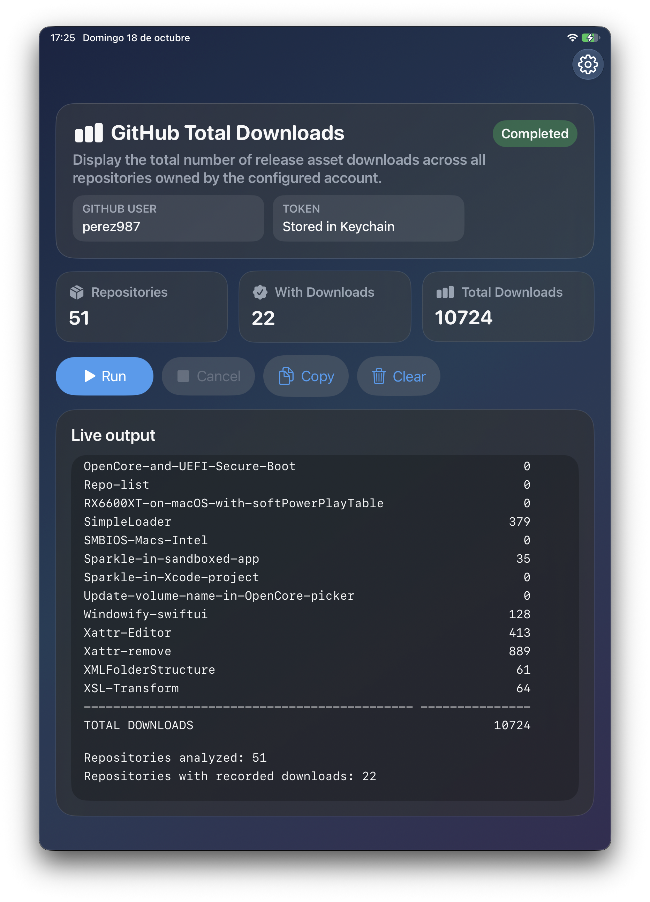
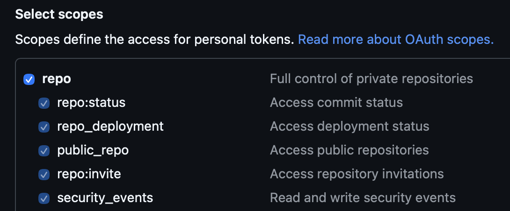

# GH Downloads: know the total count of release asset downloads of a GitHub account on iPhone and iPad


GH Downloads is a native iOS and iPadOS app built with SwiftUI that counts the release asset downloads from all repositories owned by a GitHub account and shows the per-repository counts plus the combined total.

It is the iOS port of the macOS app [GH Get Repos](https://github.com/perez987/GHGetRepos). Only the *Total Downloads* tool has been ported; the feature that downloads (clones) the repositories of a GitHub account is not included in the iOS app.

## Features

- Native SwiftUI interface for iPhone and iPad with soft gradients and glass-style panels
- Adaptive layout: scrolling layout on iPhone, full-height output log on iPad
- Latest GitHub username saved locally in `UserDefaults`
- GitHub classic private token stored securely in the iOS Keychain under the `github-release-downloads` service, available only on this device and only while it is unlocked
- Optional token: without it, the report includes only public repositories; with it, private repositories owned by the account are included too
- Summary cards with repositories analyzed, repositories with downloads, and total downloads
- Live output log with copy (to the clipboard), clear, and cancel actions. Results are not saved anywhere; copy the output if you want to keep it
- Language system (English / Spanish) with selector in the Settings sheet.

|                              |
| :--------------------------- |
|  |

## Requirements

- iOS / iPadOS 18 or later
- Xcode 16 or later
- Swift 5

## Xcode project

Open `Xcode-project/GHDownloads.xcodeproj` in Xcode 16 or later and run the **GHDownloads** scheme on an iPhone or iPad (device or simulator). To run on a physical device, select your own development team in **Signing & Capabilities**.

From the command line:

```sh
xcodebuild -project Xcode-project/GHDownloads.xcodeproj -scheme GHDownloads -destination 'generic/platform=iOS Simulator' build
```

## Configure credentials

1. Tap the **Settings** (gear) button in the top-right corner
2. Enter the GitHub username to query
3. Paste the GitHub classic token into the secure field (optional, required only for private repositories)
4. Tap **Save Token** to store it in the Keychain
5. Tap **Done** to return to the main screen.

The app uses the Keychain service name `github-release-downloads`. The token is never saved as plain text, and it is stored per GitHub username. Use **Delete Token** to remove it from the Keychain.

## Authentication with a Personal Access Token Classic

A Personal Access Token (classic) is used to authenticate requests to the GitHub API. For this app, which queries public and private data, you must generate a classic token with `repo` scope, as in the image:

|                                    |
| :--------------------------------- |
|  |

### Create the token

1. On GitHub, open **Settings**
2. Go to **Developer settings**
3. Open **Personal access tokens** >> **Tokens (classic)**
4. Click **Generate new token** >> **Generate new token (classic)**
5. Assign a description, for example: `iOS GH Downloads`
6. Choose an appropriate expiration (7, 30, 60, 90 days, custom, or no expiration date)
7. Select `repo` scope
8. Click **Generate token** and copy it immediately. GitHub does not show the full value again later.

## Report behavior

1. Tap **Run** to start the report. **Cancel** stops it at any time.
2. If a token is saved and its owner matches the configured username, the app lists every repository owned by the account, including private ones. Otherwise it lists the public repositories of the user (or organization).
3. For each repository, the app sums the `download_count` of every asset in every release.
4. The output log shows a table with the downloads per repository, the grand total, and the number of repositories analyzed and with downloads. Lines remain continuous without wrapping on iPhone, iPad, and Mac (Designed for iPad); scroll horizontally to read long lines.
5. Tap **Copy** to copy the whole output to the clipboard, or **Clear** to empty the log.
